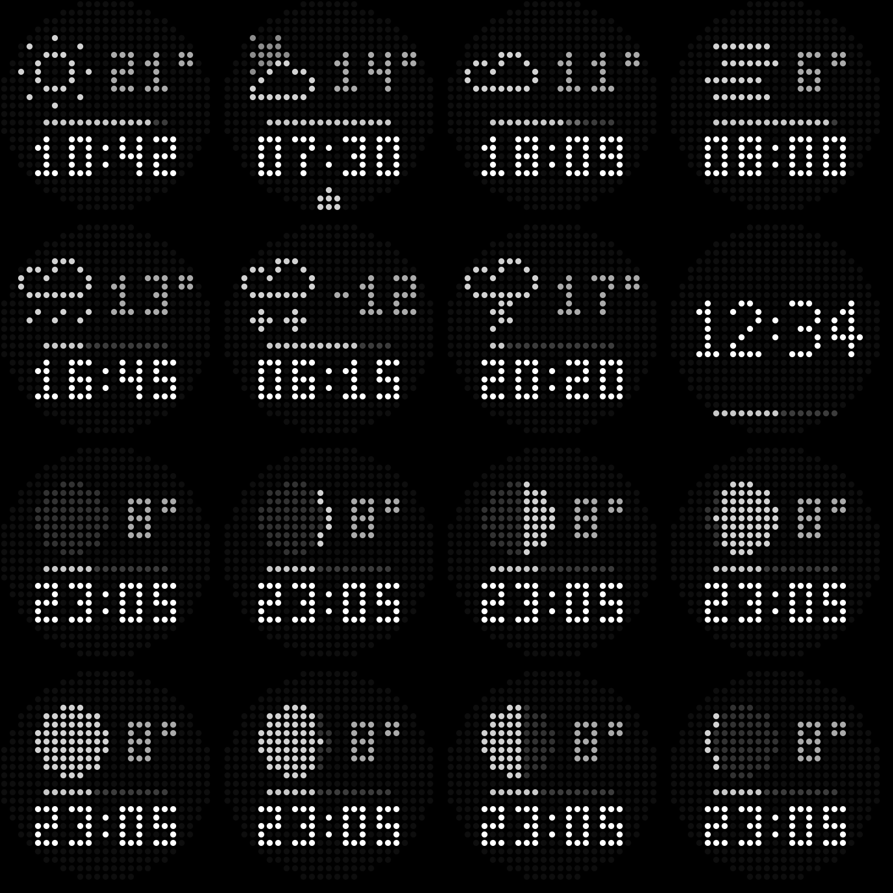

# GlyphCast

**The time, the weather and your battery, drawn in dots on the back of your Nothing Phone (3).**

GlyphCast is a [Glyph Toy](https://nothing.community/t/glyph-sdk) for the 25 × 25 Glyph Matrix. It shows a weather icon with the temperature, a battery bar and the time on one minimalist screen, and it is configured from a small companion app.



## Features

- **Time, weather and battery** on one screen, with a mirrored "time on top" layout, or weather and battery alone with the time turned off.
- **Thin pixel weather icons**: sun, sun behind clouds, clouds, fog, rain, snow and storm.
- **Real moon phase** on clear nights, computed on the phone, and a moon behind the cloud on partly cloudy nights.
- **Rain alert**: a small drop appears when rain is expected within the next hour.
- **Today's high and low**: long press the Glyph Button to see them for 5 seconds.
- **Battery bar** that sweeps while charging and blinks slowly below 15 %.
- **Night mode** that dims the matrix at night, from 23:00 to 07:00 by default.
- **Pocket detection** that turns the matrix off in a pocket but keeps it on when the phone lies face down on a table.
- **Settings with live preview**: an icon for each setting, a city picker when several places match, language, layout, °C/°F, 12/24 h, what to show, brightness and night hours.
- **Languages**: English, Spanish and Simplified Chinese, following the phone or chosen in the app.
- **Always-on** support: the toy keeps updating while the screen is off.

## Requirements

- A **Nothing Phone (3)**. GlyphCast targets its 25 × 25 Glyph Matrix (`Glyph.DEVICE_23112`).
- Android 14 or newer.
- An internet connection for the weather. The time, battery and moon phase work offline.

## Install

1. Get `bin/glyphcast.apk`, either by building it (see below) or from someone who built it.
2. Open it on the phone. Allow installing apps from that source when Android asks; if Play Protect complains, choose *Install anyway*.
3. Open **GlyphCast**, type your city and tap the search button; if several places match, pick yours from the list. The preview at the top shows the matrix as it will look.
4. Tap **Add to Glyph Toys** and enable GlyphCast. If the button does nothing, go to *Settings › Glyph Interface › Glyph Toys*.
5. Use the Glyph Button on the back to cycle to GlyphCast.

Updates install over the previous version and keep your settings, **as long as they are signed with the same key** (see [Signing](#signing)).

## Settings

| Setting | Options |
|---|---|
| Language | Auto (phone language), ES, EN, 中文 |
| On top | Weather (icon and temperature above the time) or Time |
| Temperature | °C or °F |
| Time format | Auto (phone setting), 24 h or 12 h; 12 h drops the leading zero and centres the time |
| Time | Show or hide the time; without it the icon and a large temperature fill the matrix. The time comes back while there is no weather to show |
| Weather | Show or hide the icon and temperature |
| Battery | Show or hide the battery bar |
| Rain alert | Show a drop when rain is expected within the next hour |
| Night | 35 % brightness during the night hours |
| Pocket | Turn off in a pocket, based on proximity + orientation |
| Brightness | 20–100 % |
| Night hours | Start and end time for night dimming, 23:00–07:00 by default |

Time, weather, battery, rain, night and pocket are the six tiles below the preview; long press any icon to see what it does.

Every change is applied to the matrix immediately. The refresh button next to *Updated …* fetches fresh weather right away.

## Build

The APK is built **without Android Studio or Gradle**. A single Node.js script drives Google's command-line build tools directly.

### Prerequisites

- [Node.js](https://nodejs.org) 18 or newer
- A JDK 17 or newer, providing `java`, `javac`, `jar` and `keytool` (for example [Temurin](https://adoptium.net))
- On Linux, `unzip`
- An internet connection the first time

### Build the APK

```sh
# Windows
build.cmd

# Linux / macOS
./build.sh
```

The scripts check the prerequisites and run `node build.mjs`. The result is `bin/glyphcast.apk`, about 70 KB.

### What the build downloads

On the first run it fetches, and verifies by checksum, only what it needs:

| Package | Size | Source |
|---|---|---|
| Android build-tools 34 (`aapt2`, `zipalign`, `apksigner`) | ~60 MB | dl.google.com |
| Android platform 34 (`android.jar`) | ~60 MB | dl.google.com |
| D8 8.13.25 (dex compiler) | ~18 MB | Google Maven |
| Glyph Matrix SDK 2.0 | 60 KB | Nothing's GitHub |

The tools are cached in `%LOCALAPPDATA%\recreo-android` on Windows and `~/recreo-android` elsewhere; they take about 260 MB unpacked. Set `GLYPHCAST_TOOLS` to use another folder. The Glyph SDK is stored in `vendor/`.

### Build steps

`build.mjs` runs these steps in order:

1. Compile and run `test/FaceCheck.java`, plain-Java checks of the renderer; the build stops if one fails.
2. `aapt2 compile` / `aapt2 link` the resources and manifest, which also generates `R.java`.
3. `javac --release 17` the sources against `android.jar` and the Glyph SDK.
4. `d8` turns the classes, including the Glyph SDK, into `classes.dex`.
5. `zipalign` and `apksigner` align and sign the APK.

The newer D8 from Maven is needed because the D8 bundled with build-tools 34 crashes on anonymous classes when it runs on recent JDKs. For the same reason, the app code uses lambdas and top-level classes only.

### Versioning

Bump `VERSION` in `build.mjs` (`code` and `name`) before building a release, so that Android accepts it as an update.

### Signing

The first build creates `glyph.keystore` in the tools folder. **Keep it safe**: Android only installs an update over an existing install when both are signed with the same key. If you lose it, users have to uninstall GlyphCast, losing their settings, before installing a new build.

The keystore password defaults to a fixed value in `build.mjs`, which is fine for personal builds. If you publish builds, use your own keystore and keep the password out of the repository by setting `GLYPHCAST_KEYSTORE`, `GLYPHCAST_KEY_ALIAS` and `GLYPHCAST_KEY_PASS`.

## Project structure

```
AndroidManifest.xml        App, Glyph Toy service and permissions (internet + Glyph)
build.mjs                  Build pipeline (download tools, compile, dex, sign)
build.cmd / build.sh       Wrappers that check prerequisites and run the build
res/                       Strings (en, es, zh), button icons, toy preview, locale config
src/app/glyphcast/
  Face.java                Pure-Java renderer: the scene → 25 × 25 brightness values
  Weather.java             Open-Meteo client, settings and scene assembly
  ToyService.java          Glyph Toy service: lifecycle, minute ticks, AOD, long press, animation
  Pocket.java              Proximity + accelerometer pocket detection
  Ticker.java              Minute tick receiver
  MainActivity.java        Settings screen, built in code
  MatrixView.java          On-screen matrix preview
  BrightnessListener.java  Brightness slider
test/FaceCheck.java        Renderer checks, run by the build
imgs/preview.png           Preview of the matrix
```

`Face.java` has no Android dependencies, so the build checks the matrix on the computer with plain Java (`test/FaceCheck.java`).

## How it works

- When GlyphCast is selected, the system binds `ToyService`. The service draws a frame on each minute tick, on the Always-on event and whenever a setting changes. It draws faster only while the battery bar is animating.
- Weather comes from [Open-Meteo](https://open-meteo.com) every 30 minutes; if the phone is offline, it retries after 5 minutes. A single small request returns the current conditions, the rain for the next hour in 15-minute steps, and today's high and low. Weather older than 3 hours is hidden.
- Each frame lights about 100 of the 489 LEDs, and the app does no work while the toy is not selected, so the battery impact is minimal.

## Privacy

- GlyphCast does not ask for location permission. You type a city, and only its coordinates are sent to Open-Meteo to get the weather.
- There are no accounts, analytics or ads. Settings stay on the phone.

## Licenses and credits

- **Glyph Matrix SDK**: © Nothing Technology Limited, under the [Glyph SDK End User License Agreement](https://github.com/Nothing-Developer-Programme/GlyphMatrix-Developer-Kit/blob/main/LICENSE.md).
  - The SDK may only be used to build your own apps that use its public APIs.
  - It must not be redistributed on its own, so it is **not included in this repository**; the build downloads it.
  - **Commercial use requires prior written permission from Nothing.**
- **Weather data**: [Open-Meteo](https://open-meteo.com), licensed [CC BY 4.0](https://creativecommons.org/licenses/by/4.0/). Attribution is shown in the app. The free API is for non-commercial use.
- **Android build-tools and platform**: by downloading them through the build you accept the [Android Software Development Kit License Agreement](https://developer.android.com/studio/terms).
- **D8 / R8**: BSD 3-Clause License.
- **Icons, pixel fonts and code**: original work for this project, for personal use.

Any APK built with the Glyph SDK inherits its non-commercial restriction.
